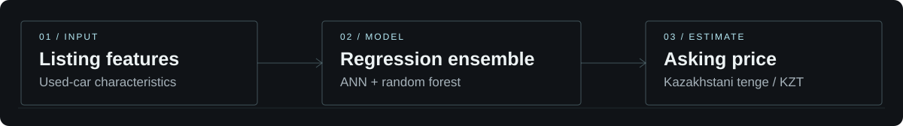

<h1 align="center">Used-car asking prices in Kazakhstan</h1>

<p align="center">
  Machine Learning Algorithms · Final Exam Project<br>
  Alisher Akhmet &amp; Aslan Muratov
</p>

<p align="center">
  <a href="https://kumawy.github.io/ML_FINAL/"></a>
  <a href="report/ML_Final_Report.pdf"></a>
  <a href="presentation/ML_Final_Presentation.pdf"></a>
</p>

<p align="center">
  
</p>

This project estimates the advertised asking price of a used car in Kazakhstan from its listing characteristics. The task is regression, with price in Kazakhstani tenge (KZT) as the target. The success criterion is at least a 20% reduction in mean absolute error (MAE) compared with predicting the training-set median. The project continues the same question, dataset and benchmark from the [endterm study](https://github.com/kumawy/ML_end).

## Results at a glance

Selected **ANN / random forest ensemble** · historical test set of **383 listings**

| Mean absolute error | R² | MAE reduction vs. median baseline |
| :---: | :---: | :---: |
| **1,634,564 KZT** | **0.9165** | **72.53%** |

The ensemble's RMSE was **3,189,732 KZT** and median absolute percentage error was **16.61%**. **224 of 383 predictions (58.49%)** fell within ±20% of the advertised asking price.

The ensemble led on MAE. The single ANN had the lowest RMSE (3,135,177 KZT) and the highest R² (0.9193). The nine pipelines used the same split and differ in their feature representations. See the [full comparison](code/results/model_comparison.csv).

K-Means found four clusters in 1,775 non-electric training listings, with a silhouette score of 0.3686. The two displayed PCA components explain 80.13% of standardized feature variance. Asking prices were excluded from the clustering and PCA inputs.

> **How to interpret these results.** Earlier test errors informed feature changes, and validation was reused. These scores describe a historical benchmark. Estimating generalization to later listings requires an independent dataset. Advertised prices also differ from final transaction prices.

## Dataset

The [Kolesa-Cars-2025 dataset](https://www.kaggle.com/datasets/mutashevdarkhan/kolesa-cars-2025) is a Kaggle snapshot of real listings compiled by mutashevdarkhan. Version 1 contains 3,999 rows and 14 source columns. Excluding new cars, used cars offered on order and duplicate listing IDs leaves 2,553 used-car listings. The fixed seed-42 split contains 1,787 training, 383 validation and 383 historical test rows. The data lack individual listing dates, verified transaction prices and reliable vehicle condition. There is no structured VIN field.

Kaggle lists the dataset under MIT. The public repository contains the source link and summary artifacts. It omits copies of individual advertisements and row-level exports given the original [Kolesa listing terms](https://kolesa.kz/content/agreement/). Use the unchanged CSV from Kaggle to reproduce the study.

## Reproduce the study

1. Clone the repository and enter `code/`.
2. Download [Kaggle dataset version 1](https://www.kaggle.com/api/v1/datasets/download/mutashevdarkhan/kolesa-cars-2025?datasetVersionNumber=1). Extract `cars_kolesa_parsed.csv` and rename it to `kolesa_cars_2025.csv` beside `run_project.py`.
3. From `code/`, create a Python 3.12 environment, run the tests and execute the pipeline:

```bash
python3.12 -m venv .venv
source .venv/bin/activate
python -m pip install -r requirements-lock.txt
python -m unittest discover -s tests -v
python run_project.py
```

On Windows, use `py -3.12 -m venv .venv` and activate with `.venv\Scripts\Activate.ps1` in PowerShell.

**Source CSV SHA-256**

```text
b348551cd876bde7d25fce79c3fcdbd05920403c567a6aedc0e0a5e19e260468
```

<details>
<summary><strong>Recorded environment and pipeline</strong></summary>

The recorded run used Python 3.12.15 with NumPy 2.5.4, pandas 3.1.1, scikit-learn 1.9.1, SciPy 1.18.1, Matplotlib 3.11.2, joblib 1.6.0 and threadpoolctl 3.8.0. See the [dependency lock](code/requirements-lock.txt) and [run environment](code/results/environment.json).

The entry point loads and cleans the source data, writes the fixed split and enriched dataset, generates training EDA, fits K-Means and PCA, then fits the supervised models and ANN. Tuning uses three training folds with preprocessing fitted within each fold. The script evaluates the frozen ensemble on the historical test split and writes the full tables, charts and fitted model to `code/results/`. The enriched data and its dictionary are in `code/dataset/`.

</details>

## Repository layout

| Directory | Contents |
| --- | --- |
| [`code/`](code/) | Python pipeline, tests, dataset documentation and published experiment outputs |
| [`report/`](report/) | Written study, literature review, references and three-page research proposal |
| [`presentation/`](presentation/) | 15-slide submission PDF |
| [`docs/`](docs/) | Interactive deck and its visual source credits |

### View the presentation locally

From the repository root:

```bash
python3 docs/serve.py
```

Use the arrow keys to navigate. Press `P` for presenter notes. Visual source credits are in the [presentation attribution](docs/assets/ATTRIBUTION.md).

## Team responsibilities

### Alisher Akhmet · data and unsupervised learning

Dataset sourcing and quality audit, cleaning and deduplication, feature definitions, four training-set EDA plots, K-Means and PCA.

Checked against the [dataset audit](code/dataset/quality_report.json) for the source checksum, 2,553 retained listings and the fixed split. The [cluster selection](code/results/cluster_selection.csv) and [PCA results](code/results/pca_variance.csv) record four clusters and 80.13% variance explained by the first two components.

### Aslan Muratov · supervised learning and evaluation

Median and supervised baselines, cross-validation and tuning, feedforward ANN and ANN/random forest ensemble, test metrics, error analysis and reproducibility.

The [comparison table](code/results/model_comparison.csv) records nine pipelines and ensemble MAE of 1,634,564 KZT on the historical test. The [ANN history](code/results/ann_history.csv), [error analysis](code/results/error_by_price_band.csv) and [evaluation tests](code/tests/test_evaluation.py) document the model checks. The full reproduction passed 40 tests and matched all 383 saved test predictions.

The work is grouped by the roles on slide 14. The checks are recorded at project level. Each team member should confirm their individual work and checks before submission.
